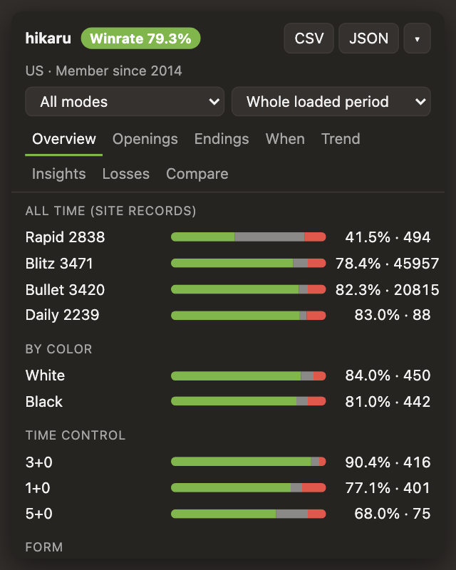
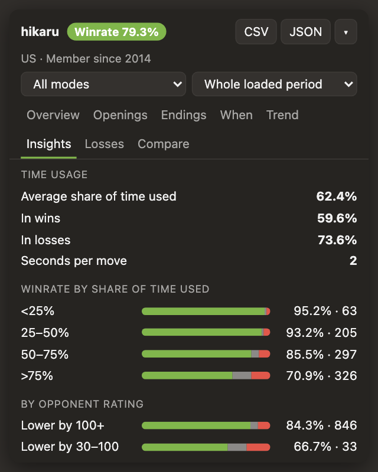
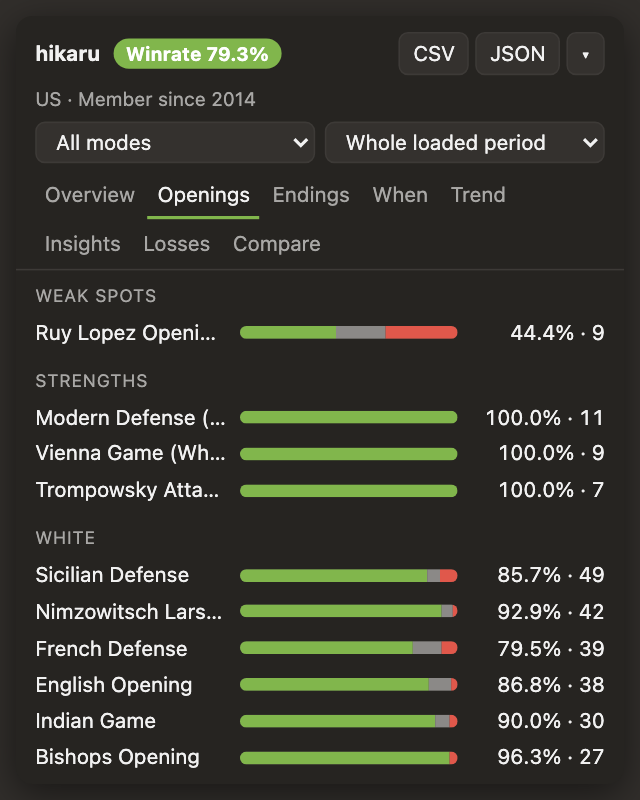
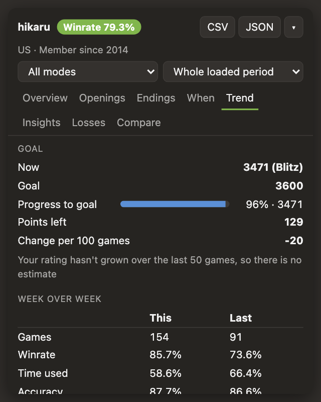

# Winrate Stats for Chess.com

[English](README.md) | [Русский](README.ru.md) | [Español](README.es.md) | **Deutsch** | [Français](README.fr.md)

[](https://github.com/belokosoff/chess-winrate/actions/workflows/ci.yml)

Eine Browser-Erweiterung für Chrome und Firefox (Manifest V3), die Spielerstatistiken auf chess.com anzeigt.
Sie nutzt nur die öffentliche chess.com-API und schlägt nie Züge vor. Inoffiziell und nicht mit Chess.com verbunden.

<p align="center">
  
  
</p>
<p align="center">
  
  
</p>

## Funktionen

- Ein Statistik-Panel auf Profilseiten (`/member/<Benutzername>`), während einer Partie (für deinen Gegner) und auf der Startseite (für deinen eigenen Benutzernamen aus den Einstellungen).
- Tabs: Übersicht, Eröffnungen, Enden, Wann, Verlauf, Analyse, Niederlagen, Vergleich und Direktvergleich.
- Siegquote nach Farbe, Eröffnung, Modus, Bedenkzeit (3+0, 10+0, …) und Zeitraum; deine stärksten und schwächsten Eröffnungen.
- Analyse: Zeitnutzung, Ergebnisse gegen stärkere und schwächere Gegner, Sitzungen (wie du nach einer Niederlage spielst) und Genauigkeit.
- Verlauf: Wertungsziel mit Prognose, Wochenvergleich sowie Diagramme für Wertung und gleitende Siegquote.
- Niederlagen: deine letzten 15 Niederlagen mit Link zur Partieanalyse auf chess.com.
- Ein Partienkalender im Tab „Wann“ und deine Aufgabenwertung in der Übersicht.
- Vergleich: zwei Spieler nebeneinander.
- Ein Hinweis „Mach eine Pause“ nach 3 Niederlagen in Folge.
- Ein `WR xx%`-Abzeichen neben Benutzernamen sowie Export als CSV und JSON.
- Helles und dunkles Design, verschiebbares Panel (Doppelklick auf die Kopfzeile setzt es zurück) und `Alt+W` zum Ein- und Ausklappen.
- Ein Einstellungsfenster: Sprache (Englisch, Russisch, Spanisch, Deutsch, Französisch), Design, Standardzeitraum und -modus, Anzahl der geladenen Monate, dein Benutzername, Ziel und Cache leeren.

## Installation

**Chrome:** Öffne `chrome://extensions`, aktiviere den „Entwicklermodus“, klicke auf „Entpackte Erweiterung laden“ und wähle diesen Ordner.

**Firefox:** Öffne `about:debugging#/runtime/this-firefox`, klicke auf „Temporäres Add-on laden…“ und wähle `manifest.json`.
Ein temporäres Add-on verschwindet nach einem Neustart von Firefox; für eine dauerhafte Installation muss es auf addons.mozilla.org signiert werden.

## Hinweise

- Der Direktvergleich wird aus deinen eigenen Partien berechnet. Gib deinen Benutzernamen im Einstellungsfenster an; sonst gilt der untere Spieler auf dem Brett als du.
- Partien werden kompakt in `storage.local` gespeichert. Vergangene Monate bleiben dauerhaft im Cache, der aktuelle Monat wird alle 5 Minuten aktualisiert.
- Der Selektor für Benutzernamen in einer Partie (`[data-test-element="user-tagline-username"]`) hängt vom Markup von chess.com ab und kann sich ändern.
- Die Genauigkeit gibt es nur für Partien, für die du die Partieanalyse auf chess.com geöffnet hast.

## Veröffentlichung

```bash
node scripts/build.js
```

Erzeugt `dist/winrate-stats-chrome-<Version>.zip` und `dist/winrate-stats-firefox-<Version>.zip`.
Schritt-für-Schritt-Anleitung und Texte für die Stores: [store/listing.md](store/listing.md). Datenschutzerklärung: [PRIVACY.md](PRIVACY.md).

## Entwicklung

```bash
node test/test.js
```

`test/harness.html` zeigt das Panel mit echten API-Daten, ohne die Erweiterung zu installieren. Starte
`python3 -m http.server 8765` im Projektordner und öffne `http://127.0.0.1:8765/test/harness.html`
(Parameter: `?user=<Name>&me=<Name>&lang=en&kind=profile&goal=450&theme=light`).

## Lizenz

MIT, siehe [LICENSE](LICENSE).
